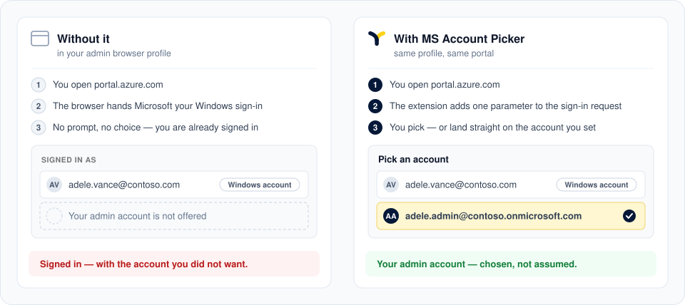
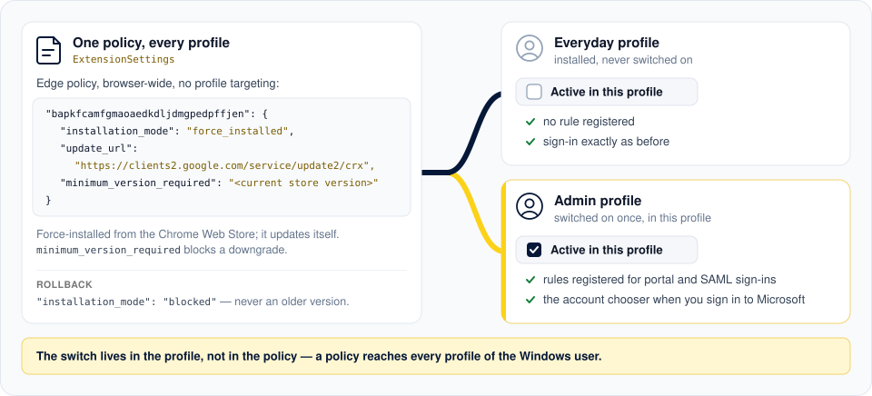

<p align="center">
  <picture>
    <source media="(prefers-color-scheme: dark)" srcset="assets/logo/mark-dark.svg">
    
  </picture>
</p>

<h1 align="center">MS Account Picker</h1>

<p align="center">
  <b>Choose which Microsoft account you sign in with — instead of being signed in automatically.</b><br />
  Built for Microsoft Edge on managed Windows devices, where the browser signs you in with your Windows account in every profile. Works in Chrome too.
</p>

<p align="center">
  <a href="https://chromewebstore.google.com/detail/ms-account-picker/bapkfcamfgmaoaedkdljdmgpedpffjen"></a>
  <a href="../../releases/latest"></a>
  
  
  <a href="LICENSE"></a>
</p>


On a managed Windows device the browser carries your Windows identity into every browser profile.
Open a Microsoft site and it signs you in with that account: no prompt, no choice. If you hold a
second Microsoft account — a separate admin identity, for instance — that is the account you did
not want, even in the profile you set up for it.

MS Account Picker gives the choice back. It adds **one query parameter** to Microsoft's sign-in
request, so you either get the account chooser or land straight on the account you configured.
That is the whole mechanism — and it does nothing in a profile until you switch it on there.

| You want to … | Go to |
| --- | --- |
| see why the browser's own settings don't solve this | [Why](#why) |
| know what exactly it changes in a sign-in | [How it works](#how-it-works) |
| choose between the account chooser and direct sign-in | [What you can set](#what-you-can-set) |
| install it and set it up | [Quick start](#quick-start) |
| roll it out to a team by policy | [Rolling out to a team](#rolling-out-to-a-team) |
| know what it can and cannot touch | [Security and footprint](#security-and-footprint) |
| know where it stops working | [Limits](#limits) |
| see what each version changed — updates arrive automatically | [CHANGELOG.md](CHANGELOG.md) |
| report a vulnerability | [SECURITY.md](SECURITY.md) |
| build it or contribute | [Development](#development) |

## Why



Switching single sign-on off is not the fix: the same Windows token supplies the device claim that
a Conditional Access policy may require. MS Account Picker leaves the Windows sign-in and its device
claim in place — confirmed in the sign-in log — and decides only which account the sign-in lands on.

| Approach | What happens |
| --- | --- |
| Edge's automatic sign-in setting | Hides the choice; single sign-on carries on underneath |
| Switching single sign-on off by policy | Not per profile — the everyday profile loses it too, and the device claim goes with it |
| An account hint in the portal link | Only the Azure and Entra portals accept one |
| A ready-made sign-in link | Cannot work: single-use `state` and the PKCE challenge cannot be built in advance |
| **MS Account Picker** | One parameter on the request the portal already sent. The Windows sign-in, the device claim and the everyday profile stay untouched |

## How it works


**Augment, never construct.** The extension builds no request of its own; it only adds to the one
the portal already sent. It never adds `prompt` and `login_hint` together, because Microsoft does
not support the combination. That is why it works on any Microsoft portal that signs in at
`login.microsoftonline.com`, without a list of client IDs.

**Third-party applications too.** Not only Microsoft's own portals. An application connected to your
tenant through SAML — AWS, for instance — signs in through the same Microsoft host, at its own
endpoint, and the same modes apply (since 0.12.0). One wrinkle if you
list such a site: it is matched on the host that *starts* the sign-in, which is often not the
address you type.

## What you can set

| Mode | What happens when you sign in |
| --- | --- |
| **Account picker** *(default)* | The account chooser always appears. Nothing about your identity is sent to get there. |
| **Direct sign-in** | Straight to the one account you entered — while that account's sign-in session is alive. Once it has expired, Microsoft shows the picker once more; the extension cannot skip that. No other account stays reachable. |
| **Only the sites I list** | Nothing changes anywhere except on the sites you name yourself. |

Two things sit alongside the mode:

- **Per site.** A site you use with more than one account can keep the picker while everything else
  goes direct — or the other way round. A site can also be set to **Browser default**, which means
  this extension leaves it alone entirely. Set it under *Exceptions for specific sites* — the exact
  host, like `portal.azure.com`; `azure.com` does not cover it.
- **Off per profile.** The extension does nothing at all until you switch it on in *this* browser
  profile. That is what makes it safe to install everywhere and switch on only where you want it — a
  profile where it was never switched on registers no rule.

*Only the sites I list* turns the failure direction around: in the other modes a site the extension
fails to recognise falls back to your global choice; here it is left alone, and you are signed in
silently with the Windows account. Choose it for a deliberately narrow setup, not as a default.

## Quick start

1. **In the profile you use for your second account** — not your everyday one — install it from the
   [Chrome Web Store](https://chromewebstore.google.com/detail/ms-account-picker/bapkfcamfgmaoaedkdljdmgpedpffjen)
   (in Edge, allow extensions from other stores when asked).
2. **Open the Extensions menu** (the puzzle piece) and click MS Account Picker; pin it while you are
   there.
3. **Tick *Active in this profile*.**
4. **Choose a mode** under *When you sign in to Microsoft*. *Account picker* is preselected. For
   *Direct sign-in*, enter the account under *Account for direct sign-in*.

Open a Microsoft portal: with the account picker, the chooser appears. The popup's footer shows how
many rules the browser actually registered; *0 rules active* means nothing is switched on. Already
signed in somewhere? Use **Sign out of Microsoft** under *Already signed in to a site?*

Rolling it out to more than yourself: [Rolling out to a team](#rolling-out-to-a-team).

## Rolling out to a team



Like the switch, the mode and the account are not policy values. Each admin switches it on and sets
them once, in their admin profile — a profile left unconfigured stays switched off, not broken.

```json
{
  "bapkfcamfgmaoaedkdljdmgpedpffjen": {
    "installation_mode": "force_installed",
    "update_url": "https://clients2.google.com/service/update2/crx",
    "minimum_version_required": "<current store version>"
  }
}
```

- **Updates arrive automatically** — no policy can pin a store item. Every [CHANGELOG](CHANGELOG.md)
  entry states up front whether rules or permissions changed.
- **Never set `minimum_version_required` above the version the store currently serves** — the
  extension is then disabled everywhere.
- **Edge force-installs a Chrome Web Store item on Windows only when the device is joined to Active
  Directory or Microsoft Entra ID.**

Signing, rollout rings and the reasoning behind each value: [docs/deployment.md](docs/deployment.md).

## Security and footprint

- **Two API permissions and one host.** `declarativeNetRequest` and `storage`, plus
  `login.microsoftonline.com`. No access to the Microsoft portals themselves.
- **It never reads a request.** The browser's `declarativeNetRequest` engine applies the rule; the
  extension never sees the requests it matches.
- **Top-level navigations only.** Silent token renewal runs in a hidden frame, which the rule never
  matches.
- **Nothing of its own leaves your browser.** No telemetry, no analytics, no error reporting. No
  account, no server. No remote code and no third-party libraries: zero dependencies.
- **Direct sign-in puts the account name into the sign-in URL**, and from there into browser history
  and proxy logs. The popup says so next to the field. It is stated, not obfuscated — Microsoft
  needs the name in clear text. The account picker sends no identity.

> [!IMPORTANT]
> The extension operates **inside the authentication flow of privileged accounts** and is
> classified as a T0 (Tier 0) influence path: whoever can ship an update to it could rewrite
> `redirect_uri` instead of `prompt` and send the sign-in to an attacker. Every change to the
> manifest, to permissions, or to a rule condition therefore requires a blocking security review —
> see [docs/security-review.md](docs/security-review.md), which also states what is known and
> accepted. To report a vulnerability, see [SECURITY.md](SECURITY.md).

## Limits

- **It decides which account you sign in as, not whether you are asked.** A few sites,
  `make.powerautomate.com` among them, keep their own session after you sign out, until the browser
  restarts.
- **Not covered:** sign-ins that use WS-Federation, which has no equivalent parameter, and the
  alternative sign-in hosts `login.windows.net` and `login.microsoft.com`.
- **The picker at SAML rests on behaviour Microsoft does not document.** It works and was confirmed
  against a real application, but Microsoft could withdraw it without notice. If it does, SAML apps
  quietly go back to the account the browser already knows. Direct sign-in at SAML uses
  `login_hint`, which is documented. Details: [docs/architecture.md](docs/architecture.md) §3.2.

## Requirements

- Microsoft Edge or Google Chrome, version 120 or later.
- Sign-ins that go through `login.microsoftonline.com` (Microsoft Entra ID).
- Built for a managed Windows device — a hybrid-joined one, for instance — where the browser
  carries the Windows identity into every profile. Anywhere else it still does what it says; it just
  has less to correct.

## Documentation

| File | Contents |
| --- | --- |
| [CLAUDE.md](CLAUDE.md) | Binding project rules, hard architecture constraints, glossary |
| [docs/architecture.md](docs/architecture.md) | The approach, rejected alternatives, empirical status |
| [docs/security-review.md](docs/security-review.md) | T0 classification, requirements, stop criterion, data protection |
| [docs/deployment.md](docs/deployment.md) | `ExtensionSettings` policy, signing, rollout, rollback |
| [docs/store-listing.md](docs/store-listing.md) | The store listing texts, permission justifications, privacy answers |
| [docs/verification-matrix.md](docs/verification-matrix.md) | Manual test matrix — portals × session states |
| [docs/open-questions.md](docs/open-questions.md) | Open decisions; shrinks as the project proceeds |
| [CHANGELOG.md](CHANGELOG.md) | What each version changed — the audit surface for auto-update |
| [SECURITY.md](SECURITY.md) | How to report a vulnerability, and what is already known and accepted |

## Development

No build step, no dependencies. What is in `src/` is what runs in the browser.

```bash
bash .claude/hooks/verify.sh       # gate: manifest JSON, node --check, unit tests
node --test tests/unit/*.test.js   # unit tests on their own
node tests/e2e/dnr.e2e.js          # e2e: the loaded extension against a local fake endpoint
python3 tools/package.py --check   # reproducible ZIP, packed twice to prove it
```

The e2e run needs a Chrome binary (`CHROME_BIN` or the Puppeteer cache) and `openssl`. It is
deliberately not part of the gate — it takes about 30 s and needs a browser. It never contacts
Microsoft: `--host-resolver-rules` points `login.microsoftonline.com` at a local server, and what
gets tested is still the production rule.

Load the extension: `edge://extensions` → developer mode → **Load unpacked** → the `src/` directory.

**Claude Code.** `.claude/skills/` holds four procedures: `verify` (success criteria and the gate),
`security-review` (the blocking checklist for changes to the manifest, permissions or rules),
`dnr-rule-check` (static rule inspection: RE2, `resourceTypes`, loop risk, endpoint coverage) and
`release` (version rules, reproducible packaging, the artefact register). `verify.sh` is also wired
as a `Stop` hook — a red tree blocks the turn from ending.

## Licence

[Apache-2.0](LICENSE). Copyright 2026 junis GmbH.

The junis name, the word mark and the logo files under `assets/logo/` and `src/icons/` are brand
assets and are **not** covered by the code licence. Neither are the images under `docs/images/` and
`assets/store/`, which carry the mark — see [NOTICE](NOTICE). Fork the
code freely; replace the mark.

MS Account Picker is not affiliated with Microsoft. Microsoft, Microsoft Edge and Microsoft Entra are
trademarks of the Microsoft group of companies; Google Chrome and Chrome Web Store of Google LLC;
AWS of Amazon.com, Inc.

---

<p align="center">Built by <a href="https://junis.de">junis GmbH</a>, Düsseldorf</p>
